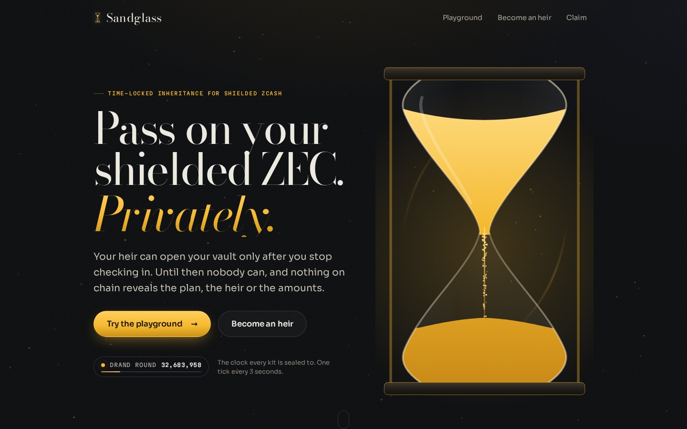
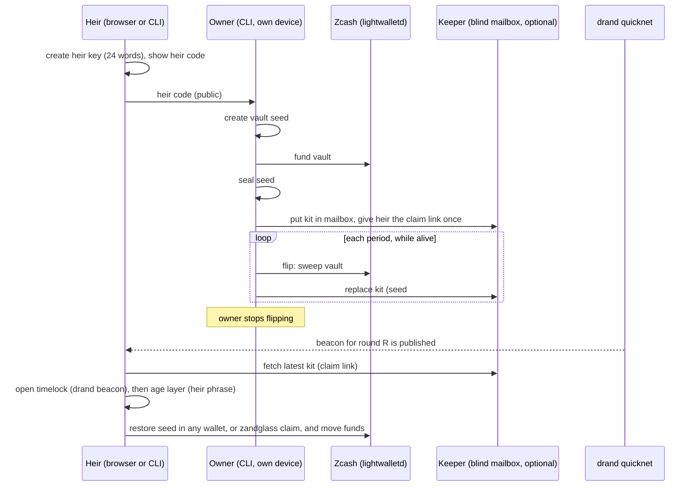
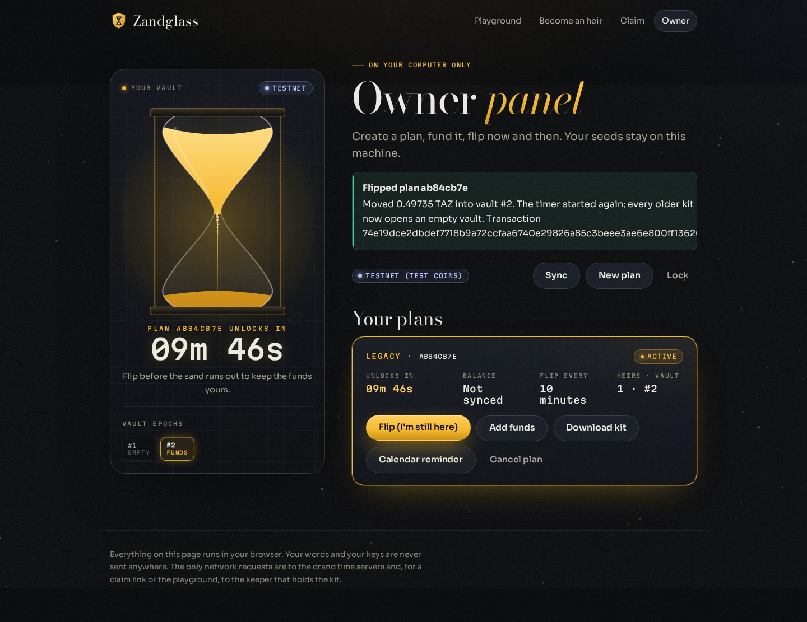

# Zandglass

**Time-locked inheritance for shielded Zcash.** Live demo: **[zandglass.cash](https://zandglass.cash)**.



Shielded Zcash has no timelocks, so there is no private way to pass it on. Zandglass gives a vault a time-locked recovery path: your heir can open it only after you stop checking in, and nothing on chain reveals the plan, the heir or the amounts.

> **Unaudited software.** Zandglass has not been audited. On mainnet the CLI prints a warning and refuses to flip a vault that holds more than 0.25 ZEC unless you pass `--accept-unaudited`. Do not use it with funds you cannot afford to lose. Built for the Zecathon hackathon (build window 2026-09-28 to 2026-10-28).

## The problem

- Shielded Zcash has no scripts, so it has no timelocks: no inheritance path, no dead man's switch.
- Heirs of shielded ZEC cannot even discover that the funds exist, because without keys nothing is visible.
- Bitcoin-style timelock inheritance publishes the recovery policy and the heir's claim on chain. Custodial services hold your keys and often know who you are.

## How it works

1. **Heir code.** Your heir creates a heir key (24 words) and gives you the public heir code (`age1...`). The phrase never leaves the heir.
2. **Seal.** Zandglass creates a **vault**: a dedicated Zcash wallet seed. It encrypts that seed twice, first to the heir code (age, X25519) and then to a future moment with [drand](https://drand.love) timelock encryption (tlock). The result is a **kit**: a small JSON file.
3. **Flip.** While you are around, you **flip** the glass now and then. Your funds move to a fresh vault (an ordinary shielded transaction) and a new kit is sealed with a later unlock time. Every older kit now opens an empty vault.
4. **The sand runs out.** If you stop flipping, the time passes. The heir opens the latest kit with the heir phrase, restores the vault seed in any Zcash wallet (or runs `zandglass claim`) and moves the funds.

There is no smart contract, no custody and no fork. Kits are standard files: if Zandglass disappears, the reference tools `tle` and `age` still open them (see [docs/KIT_FORMAT.md](docs/KIT_FORMAT.md)).



## Why it does not leak

| Party | Learns | Does not learn |
|---|---|---|
| Chain observers | Ordinary shielded transactions (funding, flips, claim) built by standard wallet code: default expiry (target + 40), default anchor, ZIP 317 fee | That a plan exists, who the heir is, amounts, unlock times, any link between vault epochs |
| drand | That someone fetched a public beacon | Anything about a kit |
| Keeper (optional) | That a mailbox exists, update times (flip times), the public part of each kit | Owner or heir identity (no accounts, no request logs), amounts, addresses, kit contents. It holds no key that opens a kit |
| CDN in front of the keeper (Cloudflare on zandglass.cash) | What the keeper sees plus IP addresses, so it could link the owner's uploads to the heir's fetches of one mailbox | Kit contents, amounts, addresses. Run your own keeper or hand over kit files to avoid it |
| lightwalletd | The usual light-client metadata (IP, sync timing) | Keys, balances (scanning is local) |
| Heir, after the unlock | The current vault's seed, so its balance | Where earlier vaults sent their funds (`OvkPolicy::Discard`) |
| Someone who steals a kit | Nothing, before or after the unlock (the heir key is also needed) | |
| Someone who steals a heir phrase | Nothing without a kit; with the kit, the vault after the unlock | |

Details, residual metadata and trust assumptions: [docs/PRIVACY.md](docs/PRIVACY.md).

## What is real and what is a mock

| Real | Mock or limited |
|---|---|
| Ordinary Zcash transactions for funding, flips and claims, on mainnet and testnet (see [evidence](docs/evidence/EVIDENCE.md)); drand quicknet timelock encryption; age X25519 heir keys; the blind mailbox; kits that open with the reference `tle` and `age` tools (`scripts/interop-kit.sh`) | In the hosted playground the server plays the owner and holds a tiny demo vault (the heir key is real and stays in your browser); playground timers are minutes, not months; unaudited, with a 0.25 ZEC mainnet cap; installments are tested on testnet only; Tor is not implemented; a claimed vault was restored and spent in a third-party wallet (zcash-devtool, testnet evidence) |

## Download

Ready-made programs for Windows, macOS (Apple silicon and Intel) and Linux are on the [Releases page](https://github.com/0xBadSign/zandglass/releases). Unpack and **double-click `zandglass`**: it opens the owner panel in your browser. Choose **Testnet** in the panel to try it with free test coins first.

- The programs are not code-signed yet. Windows SmartScreen shows "More info, Run anyway"; on macOS right-click the file, choose Open, then Open again.
- Each download has a `.sha256` file to check it. The same program runs every command from a terminal (`zandglass --help`).

## The owner panel

`zandglass ui` (or simply starting `zandglass` with no command) opens a page on your own computer to do everything without a terminal: create the encrypted store, create an inheritance plan or **scheduled payments**, fund them by scanning a QR code with any Zcash wallet, sync, **flip**, start a payment schedule, download the kit and a **calendar reminder** (`.ics`), and cancel. It listens on 127.0.0.1 only, needs the one-time session key from the address it prints, and runs the same code as the CLI. Your vault seeds never leave the machine.



`zandglass remind <plan>` writes the same calendar file from the terminal: a repeating "flip" reminder before each unlock and the unlock time itself. It holds no amounts, heirs or addresses, and no server learns your schedule.

## Quickstart (WSL or Linux)

Needs Rust stable, `protoc` and Node.js (for the web pages that the owner panel embeds). The commands below use testnet. Leave out `--network test` to use mainnet.

```bash
# 1. Build (web pages first: the CLI embeds them for `zandglass ui`)
(cd web && npm ci && npm run build)
cargo build --release -p zandglass-cli
export PATH="$PWD/target/release:$PATH"

# 2. The heir creates a key (on the heir's own device). The phrase is shown once.
zandglass heir new --save heir.phrase
#    Give the printed heir code (age1...) to the owner.

# 3. The owner creates the encrypted store (asks for a passphrase)
zandglass init --network test

# 4. The owner creates a legacy plan: flip every 10 minutes
zandglass plan legacy --heir <heir code> --every 10m --network test --out kits
#    Prints the kit file, the vault address and a ZIP 321 payment request (zcash:...).

# 5. Fund the vault from any wallet by opening the printed ZIP 321 URI, then check
zandglass status --sync --network test

# 6. Check in before the unlock time: moves the funds to a new vault, seals a new kit
zandglass flip --network test --out kits

# 7. The heir claims after the unlock time (the newest kit, or the claim link)
zandglass claim kits/<plan>-e2.zandglass --phrase-file heir.phrase --to <address> --network test --wait
```

Add `--mailbox https://<keeper>` to `plan legacy` to upload every kit to a keeper mailbox and print a claim link for the heir (`zandglass claim <claim link> ...` works with it). `claim` without `--to` prints the vault seed and birthday height so the heir can restore them in any Zcash wallet. End-to-end script with real testnet transactions: `scripts/e2e-testnet.sh`.

## Documentation

- [docs/HOW_IT_WORKS.md](docs/HOW_IT_WORKS.md): keys, the nested seal, flips, claims, time math
- [docs/PRIVACY.md](docs/PRIVACY.md): threat model, who learns what, fingerprint analysis
- [docs/KIT_FORMAT.md](docs/KIT_FORMAT.md): kit v1 and how to open one by hand
- [docs/ZIP_DRAFT.md](docs/ZIP_DRAFT.md): a draft ZIP so any Zcash wallet can offer time-locked recovery kits
- [docs/KEEPER_API.md](docs/KEEPER_API.md) and [docs/PLAYGROUND_API.md](docs/PLAYGROUND_API.md): the mailbox and playground APIs
- [docs/THIRD_PARTY.md](docs/THIRD_PARTY.md): dependencies and licenses
- [docs/evidence/EVIDENCE.md](docs/evidence/EVIDENCE.md): transactions and reproducible proofs
- [docs/PLAN.md](docs/PLAN.md) and [docs/PROGRESS.md](docs/PROGRESS.md): plan and live state
- Live site: [zandglass.cash](https://zandglass.cash): landing, [playground](https://zandglass.cash/playground), [become an heir](https://zandglass.cash/heir), [claim](https://zandglass.cash/claim), [owner panel](https://zandglass.cash/owner) (runs locally)

## Repository

| Path | What |
|---|---|
| `crates/zandglass-core` | drand rounds, sealed kits, heir keys, mailbox client |
| `crates/zandglass-wallet` | vault manager and light-client wallet |
| `crates/zandglass-cli` | the `zandglass` command and the local owner panel (`zandglass ui`) |
| `crates/zandglass-keeper` | blind mailboxes and the hosted playground |
| `web/` | landing page, playground, heir, claim and owner pages |
| `scripts/` | `check.sh`, `e2e-testnet.sh`, `interop-kit.sh` |

## License

MIT OR Apache-2.0, at your option: [LICENSE-MIT](LICENSE-MIT), [LICENSE-APACHE](LICENSE-APACHE). Third-party licenses: [docs/THIRD_PARTY.md](docs/THIRD_PARTY.md).
