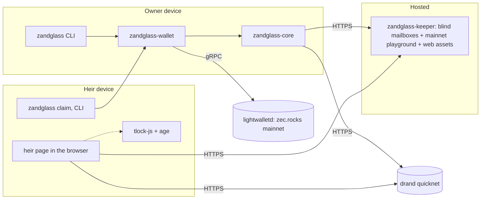

# Zandglass: Master Plan

**Working title:** Zandglass. Time-locked inheritance and scheduled payments for shielded Zcash: funds that a named person can claim only after a chosen time, unless the owner "flips" the glass. No custody, no fork, no smart contract, and nothing on chain.

**Plan version:** 2 (2026-09-30). Version 1 was built on pre-signed transactions; see 4.6 and D-009 for why that changed. **Executor:** a coding agent (plus subagents) following this document without asking the owner, except for the owner actions in section 14.

**One-line pitch:** Shielded Zcash has no timelocks, so there is no private way to pass it on. Zandglass gives every vault a time-locked recovery path: your heir can open it only after you stop checking in, and nothing on chain reveals the plan, the heir or the amounts.

---

## 0. How to use this document

- This file is the source of truth for scope, rules, architecture and milestones.
- `docs/PROGRESS.md` is the live state: where we are, what is next, decisions, evidence, blockers.
- `CLAUDE.md` (repo root) is the short operating manual. Claude Code loads it automatically.
- **Every session, read in this order:** `CLAUDE.md`, then this file (at least sections 2.4, 2.5 and the current milestone in section 9), then `docs/PROGRESS.md`.
- The plan may change when evidence requires it. Record the change as a decision (`D-xxx`) in `PROGRESS.md` and bump the plan version line above.
- All dates and times are UTC.

---

## 1. Mission

1. Win Zecathon. Target the **Shielded Payments** track ($15,000) and the **Grand Prize** ($20,000).
2. Ship a working, open-source product **on Zcash mainnet** that judges can open and use, with mainnet transactions as evidence.
3. Build it so it can continue as a real product after the hackathon (section 16).

---

## 2. The hackathon: Zecathon

### 2.1 Facts

| Item | Value |
|---|---|
| Name | ZECATHON, "a Zcash privacy hackathon" |
| Presented by | "zkSNARKs", a pseudonymous team behind a Zcash NFT collection and the Zilkroad marketplace (they raised about 12,000 ZEC in a blind auction, 2026-09-17/18) |
| Site | https://thezecathon.com (interactive terminal UI; accounts and submissions are stored in the organiser's database; the forms use a CAPTCHA) |
| Theme | "Thirty days to build something on Zcash that does not leak." |
| Prize pool | $100,000 |
| Tracks ($15,000 each) | Shielded Payments; Private Markets; Cross-Chain; Core & Tooling; Wildcard |
| Grand Prize | $20,000 for the best overall submission, on top of its track prize |
| Community bounties | $5,000 in smaller bounties posted during the build window |
| Prize payment | In ZEC, to a shielded address provided at submission |
| Registration and submissions open | 2026-09-28 |
| **Submissions due** | **2026-10-28 23:59 UTC** |
| Judges revealed | 2026-10-29 16:00 (six seats) |
| Judging | 2026-10-29 to 2026-11-22 |
| Winners announced | 2026-11-23 16:00 |

Track descriptions (from the site):
- **Shielded Payments:** point of sale, payroll, remittance, subscriptions. Money that moves without publishing who paid whom.
- **Private Markets:** sealed-bid auctions, order flow, settlement. The price is public and the participants are not.
- **Cross-Chain:** swaps, bridges and intents that reach other chains without unshielding on the way through.
- **Core & Tooling:** Zebra, librustzcash, indexers, wallet SDKs, provers. The unglamorous work everything else is built on.
- **Wildcard:** art, games, social, hardware. Anything that makes a shielded transaction worth making.

The owner is already registered. Personal identifiers stay out of this repository (15.6).

**Testnet or mainnet?** Neither the rules, the FAQ, the resources list nor the site's data file mention it (checked 2026-09-30). The criteria (2.4) ask whether someone would use it "on Monday" and whether it runs. Therefore every judge-facing part (demo, evidence, video) is on **mainnet** (D-007). Testnet is used only for development and automated tests.

### 2.2 Rules (from the site's RULES / FAQ)

1. One person registers and submits. The prize goes to that account; build with anyone.
2. All code written during the build window. Libraries are fine; existing products are not.
3. Open source at submission. A private repo made public on Oct 28 counts.
4. One submission per account, entered in exactly one track.
5. Submissions stay sealed until judging opens. You can edit yours until the deadline.
6. Organisers and judges cannot enter.

From the FAQ: prizes are paid in ZEC to a shielded address given at submission.

### 2.3 Submission form (from the site)

| Field | Constraint | Our plan |
|---|---|---|
| Project name | required, max 64 characters | "Zandglass: time-locked inheritance for shielded Zcash" (53 characters) |
| Track | required, exactly one | Shielded Payments (D-001) |
| Description | required, max 2,000 characters; "What it does, why it does not leak, what is real and what is a mock. Judges read this first." | Drafted in `docs/SUBMISSION.md` (T4.4) |
| Code repository | required URL; may be private until the deadline, must be public by then | GitHub repository (O-1) |
| Working demo | required URL; "Something the judges can open and use." | Mainnet playground and heir page (M3) |
| Demo video | required URL; two minutes; YouTube, Loom or any link | MP4 hosted on the demo site or a GitHub Release (T4.3) |
| Checkbox | "The repository will be public by the deadline. I understand a private repo at the deadline is not judged." | Owner ticks it at submission |

- SAVE DRAFT stores a draft. SUBMIT seals the submission.
- Saving a draft after submitting takes the submission back out of "submitted" until SUBMIT is pressed again.

### 2.4 Judging criteria

These come from the site's data file (`darkpool/data.js`); the UI does not show them.

| Criterion | What the site says (paraphrased, with short quotes) | What it means for us |
|---|---|---|
| **Privacy** | Does it really preserve privacy, or only look like it? "Leaks are disqualifying, not deductions." | **Zero on-chain fingerprints** (this is why we moved away from pre-signed transactions, 4.6). The privacy document is rigorous and honest about the remaining metadata (6.2). |
| **Usefulness** | "Would someone use this on Monday." | A real problem (inheritance, scheduled payments), real mainnet, and a heir who can claim with any Zcash wallet. |
| **Execution** | "Does it run." "Working beats ambitious." | Musts first; stretch goals only after all Musts are verified; polish and reliability over features. |
| **Originality** | "Built for this hackathon, not repackaged." | Fresh repository and code (C-1); no ZecPort code; a design not seen on Zcash before. |

Lesson from past Zcash hackathons: the Zcash x NEAR hackathon (March 2025) awarded only first places because overall quality was low. A polished, working demo is decisive.

### 2.5 Compliance checklist (all must be true at submission)

- [ ] **C-1** Repository created on or after 2026-09-28, and all project code written in the window (the git history shows it). Nothing is copied from pre-window products, including the owner's deleted ZecPort project. Never reconstruct code from old transcripts.
- [ ] **C-2** Third-party code arrives only as libraries through package managers (crates.io, npm). A patched fork of a library, if unavoidable, is documented in `docs/THIRD_PARTY.md` with its license.
- [ ] **C-3** Open-source license at the root (MIT OR Apache-2.0). Repository public by 2026-10-28 23:59 UTC; target 2026-10-26.
- [ ] **C-4** One submission, one track: Shielded Payments.
- [ ] **C-5** The registered owner submits. The agent never signs in to the hackathon site.
- [ ] **C-6** Description of 2,000 characters or less, covering "why it does not leak" and "real vs mock".
- [ ] **C-7** Mainnet demo URL live and usable without special setup (a judge code is allowed), kept up until 2026-11-23.
- [ ] **C-8** Video of 2:00 or less, reachable by a public link.
- [ ] **C-9** No private owner data in the repository: no emails, phone numbers, messenger handles, server credentials, home paths, or the judge code.
- [ ] **C-10** `main` frozen at the deadline and tagged `zecathon-submission`.
- [ ] **C-11** No known privacy leak (2.4): the privacy review (T4.1) finds no on-chain fingerprint and documents all residual metadata.

---

## 3. Product

### 3.1 The problem

- Shielded Zcash has no scripts, so it has **no timelocks**. That rules out several things:
  - no inheritance path;
  - no dead man's switch;
  - no cancelable scheduled payments.
- **Heirs of shielded ZEC cannot even discover that the funds exist.** Without keys nothing is visible, so privacy makes the inheritance problem worse.
- Existing inheritance services (Casa, Nunchuk, Unchained) do not support ZEC, hold keys or require KYC. Privacy-minded holders will not use them.
- Bitcoin-style timelock inheritance (Liana, BIP 128) publishes the recovery path and the heir's receipt on chain.
- The scale: about 5 million ZEC is shielded. Industry-wide, an estimated 2.3 to 3.7 million BTC is permanently lost, and only about 17% of holders have documented inheritance instructions.

### 3.2 The solution: the sealed vault

A **vault** is a dedicated Zcash wallet seed that holds the funds a plan covers. Zandglass encrypts the vault's seed twice:
- to a **future moment**, with drand quicknet timelock encryption; nobody can open it before then;
- to the **heir's key**; after that moment only a listed heir can open it.

The owner "flips" the glass to reset the timer. A flip moves the funds to a fresh vault with a later unlock time, so every older kit opens an empty vault.

If the owner stops flipping, the time passes. The heir opens the kit, receives the vault's seed and moves the funds with any Zcash wallet.

On chain, every step is an ordinary shielded transaction built at the moment it is sent.

### 3.3 Use cases

| Use case | What it is | Status |
|---|---|---|
| **Legacy vault** (flagship) | Inheritance / dead man's switch, with 1 to 3 heirs (any one of them can claim) | Must |
| **Installments** | Scheduled payments that stay cancelable (allowances, subscriptions, salaries): N small vaults, each unlocking for the payee at its due date; cancelling sweeps the remaining vaults back | Must (minimal) |
| **Time capsule** | A gift that opens on a date (an installment with one payment) | Must (falls out of installments) |
| **Auto-delivery** | Pre-signed payments that anyone can broadcast after the unlock, for recipients who cannot hold a key; it leaves a recognisable on-chain pattern, so it is opt-in with a warning | Stretch (S1) |

### 3.4 Scope (MoSCoW)

**Must (the submission is not complete without these):**
- M-1 `zandglass-core`: drand round math; nested sealing (timelock and heir keys); heir keys (24-word phrase to an age X25519 identity; public "heir code"); kit format v1; mailbox client.
- M-2 `zandglass-wallet` and the `zandglass` CLI:
  - vault manager (one seed per epoch, encrypted at rest), sync, balances, standard sweeps;
  - commands: `heir new`, `init`, `receive`, `plan legacy`, `plan installments`, `flip`, `cancel`, `status`, `claim` (restore and sweep), `kit inspect`.
- M-3 `zandglass-keeper`: a blind mailbox for the latest kit of each plan (it can never decrypt); the mainnet playground backend; serves the web assets.
- M-4 Heir page: creates a heir key in the browser (phrase and heir code). It claims a kit: countdown, then decryption in the browser after the unlock, then the vault seed with restore instructions for common wallets.
- M-5 Mainnet playground a judge can finish in about 5 to 10 minutes.
- M-6 Mainnet evidence: txids for funding, flips, a heir claim, installments, and a live vault that unlocks during judging. Plus an interoperability proof that a kit opens with the reference `tle` and `age` tools.
- M-7 Documentation, the 2-minute video and the submission texts.

**Should:**
- S-A The live vault on mainnet unlocks on about 2026-11-12, during judging, and is visible on the landing page.
- S-B Tor or custom-lightwalletd options in the CLI (network privacy).

**Could (stretch, in this order; only after all Musts are done and verified):**
- S1 Auto-delivery mode (pre-signed transactions) with the fingerprint warning; testnet evidence including a NU7 crossing.
- S2 A local web UI for the owner (the same frontend, served by the CLI).
- S3 Reminders and alerts (owner check-in reminders, heir "ready" alerts), opt-in.
- S4 k-of-n heirs (Shamir or age plugins) instead of any-one-of.
- S5 In-browser sweep for heirs (a WASM wallet), so the heir never handles a seed phrase.
- S6 FROST escrow with a time-locked refund.

**Won't (during the hackathon):**
- mobile apps, paid tiers, tokens;
- a custodial service for other people's money;
- cross-chain, ecash;
- anything unrelated to time-locked vaults.

### 3.5 Vocabulary (use it consistently in the code, the UI and the docs)

| Term | Meaning |
|---|---|
| **Vault** | A dedicated Zcash seed holding a plan's funds; each flip creates the next vault ("epoch") |
| **Plan** | A legacy plan or an installment schedule |
| **Heir key / heir phrase / heir code** | A heir's X25519 key, backed up as 24 words; the heir code is the public part the owner needs |
| **Seal** | Encrypt a vault seed to the heir codes and then to a drand round |
| **Kit** | The file (`*.zandglass`, JSON) holding a sealed vault plus public metadata |
| **Mailbox** | Where the keeper holds the latest kit of a plan; the heir's claim link points to it |
| **Flip** | The owner's check-in: move the funds to a new vault and seal it with a later unlock time |
| **Claim** | After the unlock, a heir opens the kit and moves the funds |
| **Keeper** | The service that hosts mailboxes (and the playground); it can never decrypt a kit |

---

## 4. How it works

### 4.1 Keys and objects

- **Vault seed:** a BIP 39 24-word mnemonic generated by Zandglass for each epoch; the wallet uses account 0 only. It is stored encrypted on the owner's device. The birthday height is recorded.
- **Heir key:**
  - 24 words (BIP 39) are turned into an X25519 secret (HKDF-SHA256, domain `zandglass-heir-v1`) and used as an **age identity**;
  - the **heir code** is the age recipient string (`age1...`), shown with a checksum-friendly display;
  - it is generated in the heir's browser or CLI and never sent anywhere.
- **Kit:**
  - `sealed = tlock_R( age_to(heir_codes, payload) )`;
  - the payload holds the vault seed, the birthday height, the network, the plan and epoch, an optional message and restore hints.
- **Mailbox:**
  - the keeper stores the latest kit per plan, under a random ID with separate write and read tokens;
  - the claim link is `https://<host>/claim#m=<id>&r=<read-token>` (pages are served at clean addresses: `/playground`, `/heir`, `/claim`).

### 4.2 Properties

- **P1 Time-gated.** Nobody, heir included, can open a kit before round R, unless a threshold of the League of Entropy drand nodes collude.
- **P2 Heir-gated.** After R, only the holder of a listed heir key can open it (age X25519). A leaked kit is useless to anyone else.
- **P3 Revocable.** A flip moves the funds to a fresh vault. Any older kit opens an empty vault.
- **P4 No on-chain footprint.** Funding, flips, splits and claims are ordinary shielded transactions, built by standard wallet code when they are sent: current anchor, standard expiry, ZIP 317 fee. Flips use `OvkPolicy::Discard`, so an old vault's keys cannot see where its funds went. Nothing marks a transaction as Zandglass.
- **P5 Upgrade-proof.** Kits hold keys, not transactions, so network upgrades (NU7 on 2026-11-05, or later ones) never make them stale.
- **P6 Claim with any wallet.** The heir restores the vault seed, with its birthday height, in any Zcash wallet, or uses `zandglass claim --to <address>`.
- **P7 No lock-in.** Kits are standard files: drand tlock armour around an age file. If Zandglass disappears, heirs can still open them with the reference tools (`tle` from drand, then `age`).

### 4.3 Legacy vault

```mermaid
sequenceDiagram
    participant H as Heir (browser or CLI)
    participant O as Owner (CLI, own device)
    participant Z as Zcash mainnet (lightwalletd)
    participant K as Keeper (blind mailbox)
    participant D as drand quicknet
    H->>H: create heir key (24 words), show heir code
    H->>O: heir code (public)
    O->>O: create vault seed #1 and plan (heir codes, period, message)
    O->>Z: fund vault #1 (ZIP 321 request, any wallet)
    O->>O: seal seed #1 to heir codes, then to round R1 = now + period
    O->>K: put kit in mailbox; give heir the claim link once
    loop each period, while alive
        O->>Z: flip: sweep vault #k to new vault #k+1 (ordinary tx)
        O->>K: replace kit (seed #k+1, round R(k+1))
    end
    Note over O: owner stops flipping
    D-->>H: beacon for round R is published
    H->>K: fetch latest kit (claim link)
    H->>H: open timelock (drand), then age layer (heir key), get vault seed
    H->>Z: restore seed in any wallet and move funds (ordinary tx)
```

Notes:
- The owner can still move the funds after R (a race), which is the same as Bitcoin timelock recovery.
- Reminders (S3) reduce the risk of an accidental unlock.
- Several heirs: the inner age layer lists 1 to 3 heir codes, and any one of them can claim.

### 4.4 Installments (allowances, subscriptions, time capsules)

1. The owner funds a funding vault, then splits it into N installment vaults, one seed each, holding exactly the installment amount (one ordinary transaction).
2. Each installment vault i is sealed to the payee's heir code (here, the payee code) and to round R_i, its due time.
3. The kits go to the payee's mailbox.
4. The payee claims each installment when it is due, by hand or automatically: `zandglass claim --watch --to <address>` on the payee's own server.
5. **Cancel:** the owner sweeps the remaining installment vaults back. Future kits then open empty vaults.
6. Each installment is an ordinary transaction; nothing on chain links installments together.

### 4.5 Time: drand quicknet

- Chain hash `52db9ba70e0cc0f6eaf7803dd07447a1f5477735fd3f661792ba94600c84e971`, period 3 s, genesis time 1692803367. Pin these after verifying against `https://api.drand.sh/<chain-hash>/info` in M0.
- `round_at(t) = floor((t - genesis) / period) + 1`
- Unlock at time T: `R = ceil((T - genesis) / period) + 1`
- Unlocking is driven by wall-clock time, not block height. The NU7 block-time change (75 s to 25 s) does not matter.

### 4.6 Why not pre-signed transactions (plan version 1)?

Plan v1 sealed fully signed transactions with `nExpiryHeight = 0`. They are non-redirectable and permissionless to broadcast, but they have two problems:
- **On-chain fingerprints.** Expiry 0 is rare, and the anchor is old at broadcast time. Such a transaction is recognisable as pre-signed. The criteria say leaks disqualify, so this is not an acceptable default.
- **Staleness.** The signature commits to the consensus branch ID, so every network upgrade invalidates kits unless there are variants. That is fragile over years.

The idea stays as the opt-in **auto-delivery** mode (S1), for recipients who cannot hold a key, with the trade-off stated in the UI and the docs.

### 4.7 Compared with other approaches

- **Timelock-encrypting a seed alone** (drand's own dead man's switch example; Chronolox): whoever holds the ciphertext gets the key after the unlock. Zandglass adds the heir-key layer (P2), revocation by rolling vaults (P3) and installments.
- **Bitcoin timelock paths** (Liana, BIP 128): the recovery policy and the heir's claim are public on chain. With Zandglass nothing is (P4).
- **Custodial or collaborative custody** (Casa, Nunchuk, Unchained): a company holds a key and usually knows the customer. Zandglass holds no keys and knows no one.

---

## 5. Architecture

### 5.1 Components



| Component | Kind | Responsibility |
|---|---|---|
| `zandglass-core` | Rust library | drand client and round math; nested seal/open (tlock and age); heir keys; kit v1; mailbox client |
| `zandglass-wallet` | Rust library | light-client wallet over `zcash_client_sqlite`: vault manager (epochs, encrypted seeds), sync, balances, sweep, split, claim-by-restore |
| `zandglass-cli` | Rust binary `zandglass` | the owner's, heir's and payee's tool |
| `zandglass-keeper` | Rust binary | blind mailbox API; mainnet playground backend; serves the built web assets |
| `web/` | TypeScript (Vite) | landing page, mainnet playground UI, heir page (create a key; claim); also built as a standalone static site for GitHub Pages |

### 5.2 Repository layout

```
zandglass/
  CLAUDE.md
  README.md
  LICENSE-MIT
  LICENSE-APACHE
  Cargo.toml                 # workspace
  crates/
    zandglass-core/
    zandglass-wallet/
    zandglass-cli/
    zandglass-keeper/
  web/                       # Vite + TypeScript
  deploy/                    # docker compose, Caddyfile
  scripts/                   # check.sh, e2e-testnet.sh, e2e-mainnet.sh, record-video.mjs
  docs/
    PLAN.md  PROGRESS.md  HOW_IT_WORKS.md  PRIVACY.md  KIT_FORMAT.md
    KEEPER_API.md  THIRD_PARTY.md  SUBMISSION.md  DEMO_SCRIPT.md
    evidence/EVIDENCE.md
  .private/                  # gitignored: seeds, judge code, server access, owner notes
```

### 5.3 Stack and versions

- **Rust:** stable. librustzcash cohort as of the Ironwood final release (2026-08-19):
  - `zcash_client_backend` 0.24.0
  - `zcash_client_sqlite` 0.22.0
  - `zcash_primitives` 0.30.1
  - `zcash_protocol` 0.10.5
  - `zcash_keys` 0.16.1
  - `pczt` 0.9.3
  - `orchard` 0.15.5
  - `zcash_proofs` 0.30.0
  - `zip321` 0.9.0

  **T0.3 picks the final versions.** Mainnet NU7 on 2026-11-05 falls during judging, so plan a dependency bump (T6.1). Record the exact versions in `PROGRESS.md`.
- **Encryption:** `tlock_age` (MIT; age format; interoperable with Go `tlock` and `tlock-js`) plus the `age` crate (X25519 recipients); HKDF; `bip0039`; `zeroize`.
- **Networking and services:** `tonic` gRPC for lightwalletd (through the lightwalletd client feature of `zcash_client_backend`); `axum`, `tokio`, `rusqlite`, `serde`, `clap`.
- **Web:** TypeScript, Vite, `tlock-js` + `drand-client`, `age-encryption` (the TypeScript age library), a BIP 39 library, a QR library, Playwright and axe for browser tests.
- **Style:** no inline scripts and no third-party trackers. The Content-Security-Policy allows `connect-src` only to self and the drand endpoints.

### 5.4 Kit format v1 (`*.zandglass`, JSON)

Public part:

```json
{
  "format": "zandglass-kit",
  "version": 1,
  "kind": "legacy | installment",
  "network": "main | test",
  "created": "2026-10-05T12:00:00Z",
  "plan": "random 128-bit hex",
  "epoch": 3,
  "sequence": { "index": 1, "count": 12 },
  "unlock": {
    "drand_chain": "52db9ba70e0cc0f6eaf7803dd07447a1f5477735fd3f661792ba94600c84e971",
    "round": 12345678,
    "time": "2026-12-31T00:00:00Z"
  },
  "sealed": "-----BEGIN AGE ENCRYPTED FILE----- ... (tlock armour)"
}
```

The layers inside `sealed`:
- the outer layer is tlock to `unlock.round`;
- inside it is an age file encrypted to 1 to 3 X25519 heir codes;
- inside that is the payload.

Payload:

```json
{
  "vault_seed": "24 words",
  "birthday_height": 3500000,
  "network": "main",
  "plan": "…",
  "epoch": 3,
  "message": "optional words from the owner",
  "restore_hints": ["Zodl: Restore > enter words > birthday height", "…"]
}
```

Rules:
- The public part never contains amounts, addresses, seeds or txids.
- Unknown fields are ignored and unknown versions are rejected.
- The format is documented in `docs/KIT_FORMAT.md`, including how to open a kit by hand with `tle` and `age`.

### 5.5 Keeper API v1 (blind mailbox and playground)

| Method and path | Purpose |
|---|---|
| `POST /v1/mailboxes` | Returns `{ id, write_token, read_token }` |
| `PUT /v1/mailboxes/{id}/kit` | With `write_token`. Replaces the kit (the previous one is deleted) |
| `GET /v1/mailboxes/{id}/kit` | With `read_token`. The latest kit |
| `DELETE /v1/mailboxes/{id}` | With `write_token` |
| `GET /v1/health` | Liveness |
| `/v1/playground/*` | Mainnet playground sessions (5.8), behind the judge code |

- The keeper never has a key that opens a kit, even after the unlock.
- It stores only the kit, the update times and the token hashes. Mailboxes are deleted 180 days after the last update or on request.
- **Privacy:** no request logs with IPs; no analytics.

### 5.6 Wallet and keys

- **Vault seeds:**
  - generated per epoch;
  - stored encrypted with an age passphrase at `~/.zandglass/<network>/vaults/`;
  - zeroized in memory where the libraries allow;
  - the owner can export a backup of all current vault seeds.
- **Heir keys** are generated on the heir's side only. The owner's tool accepts heir codes and nothing else.
- **Mainnet is the default** for the product. Testnet is selected with `--network test`.
- Until an external audit, the CLI:
  - shows a clear "unaudited" warning;
  - caps a plan at 0.25 ZEC unless `--accept-unaudited` is given (the cap protects early users from our bugs, not from the design).

### 5.7 Transactions (all ordinary)

| Step | Transaction |
|---|---|
| Fund | From any wallet, using the ZIP 321 request shown by `zandglass receive` |
| Flip | Sweep vault k to vault k+1, `OvkPolicy::Discard` |
| Split (installments) | One transaction from the funding vault to N installment vault addresses |
| Cancel | Sweep the remaining vaults back to the owner's chosen address or a fresh vault |
| Claim | The heir's wallet, or `zandglass claim`, sweeps the vault to the heir's address |

- All of them are built with the standard `zcash_client_backend` proposal flow at send time, with default expiry and anchor and the ZIP 317 fee.
- **No Zandglass-specific memo text** (memos are optional and free text from the user).

### 5.8 Mainnet playground (hosted, for the judges)

- **Access:** a judge code (given only in the submission form, never in the repository), plus rate limits per IP and a daily budget cap.
- **Roles:** the server plays the owner and holds a small **demo float**. The visitor plays the heir. **The heir key is generated in the visitor's browser and never leaves it.**
- **Session flow (about 5 to 10 minutes):**
  1. "Become an heir": create a heir key in the browser (the phrase can be skipped in the demo) and get the heir code.
  2. "Start a vault": the server creates a vault funded with 0.0002 ZEC from the float (a real mainnet transaction), seals it to the visitor's heir code with a 3, 5 or 10 minute timer, and puts it in a mailbox.
  3. The visitor watches the countdown and may press **Flip** (a real mainnet sweep to a new vault; the timer resets) or **Stop flipping**.
  4. After the unlock, the visitor opens the kit in the browser. It is decrypted locally and the vault seed appears. The visitor can:
     - "Keep it": restore the seed in their own Zcash wallet (at most 5 a day; otherwise the demo returns it);
     - "Send it to my address": the page asks for a unified address and the server sweeps;
     - "Return it": the server sweeps back to the float.
  5. Show the mainnet txids with explorer links.
- **Caps:**
  - at most 10 concurrent sessions;
  - at most 60 sessions a day;
  - 0.0002 ZEC per session, returned to the float by default;
  - the float holds at most what the owner funded (O-5).
- **Labels:** "Mainnet demo. Here the server plays the owner and holds the demo vault. In real use the owner runs Zandglass on their own device. Your heir key never leaves this browser." This is the main "mock" in the submission.
- Exactly the same core and wallet code as the CLI.

### 5.9 Heir page (static, client-side)

- **Create a heir key:**
  - generate 24 words in the browser and show them for backup (confirm by re-entering 3 words);
  - show the heir code with a copy button and a QR code;
  - store nothing unless the user opts in (local storage for the demo only).
- **Claim:**
  - load a kit from a claim link (mailbox) or a file;
  - show the unlock time and a live countdown;
  - after the unlock: fetch the beacon from drand; open the tlock layer (`tlock-js`); ask for the heir phrase; open the age layer; show the vault seed, the birthday height, the owner's message and restore steps for Zodl, Zkool, Vizor, Zingo and `zandglass claim`.
- Plain-language states:
  - waiting;
  - ready;
  - wrong heir key;
  - kit damaged;
  - this vault was moved (an old kit: point to the latest one in the mailbox);
  - network error (retry).
- Mobile-first, accessible (axe clean), English only.
- **Offline mode:** the page works from a saved copy (only drand is needed to open).

### 5.10 Error codes (CLI, keeper and web share them)

`kit_invalid`, `kit_version_unsupported`, `not_yet_unlocked`, `beacon_unavailable`, `wrong_heir_key`, `decrypt_failed`, `vault_empty` (moved or claimed), `network_mismatch`, `amount_over_cap`, `insufficient_funds`, `sync_required`, `mailbox_not_found`, `unauthorized`.

---

## 6. Privacy and security model (also feeds `docs/PRIVACY.md` and the submission)

### 6.1 Who learns what

| Party | Learns | Does not learn |
|---|---|---|
| Chain observers | ordinary shielded transactions (fund, flip, split, claim) that look like any wallet's | that a plan exists, the heir, amounts, unlock times, any link between vault epochs |
| drand network | at most, that someone fetched a round's beacon (public data) | anything about the kit |
| Keeper | that a mailbox exists; kit update times; the unlock round (public part of the kit) | owner or heir identity (no accounts, no IP logs), amounts, addresses, contents (it cannot decrypt, ever) |
| lightwalletd (any light wallet's server) | the light-client queries and IP of whoever syncs (standard light-wallet metadata) | keys, balances (compact-block scanning is local) |
| Heir, after the unlock | the current vault's seed, so its balance and its one incoming transfer (intended) | earlier vaults' destinations (`OvkPolicy::Discard`), the owner's other funds |
| Someone who steals a kit | nothing, before or after the unlock (heir key required) | |
| Someone who steals a heir phrase | nothing until the unlock, then the vault (so the heir must guard the phrase; several heirs are possible) | |

### 6.2 Residual metadata (documented honestly)

- **R1 Light-wallet network metadata:** lightwalletd sees the IP and sync timing, as with every Zcash light wallet. Mitigation: `--lightwalletd` for your own server; Tor support (S-B).
- **R2 Mailbox metadata:** the keeper sees when a kit is replaced (flip times) and the unlock round. Mitigation: the owner can skip the mailbox and hand kit files to heirs directly. No IPs are logged.
- **R3 drand fetch timing:** a claimant fetches a public beacon. Mitigation: fetch the latest beacon (after the unlock, any later beacon is not needed; tlock needs round R's signature, which is public and cacheable). The heir page can use several drand relays.
- **R4 Owner race after the unlock:** by design, like Bitcoin timelock recovery. Mitigation: reminders (S3).

The on-chain footprint is **none** (P4). This is verified in T4.1 by comparing our transactions' fields (expiry delta, anchor age, fee, action count patterns) with those of ordinary wallet transactions.

### 6.3 Trust assumptions

- **T1 drand.**
  - Threshold honesty: a colluding threshold could open the timelock layer early, but still not the heir layer.
  - Liveness: if drand halts, kits cannot open until it resumes; the funds stay with the owner's vault.
- **T2** The security of the owner's and heirs' devices.
- **T3** Any lightwalletd will do (zec.rocks by default).

### 6.4 Real vs mock (for the submission)

| Real | Mock or limited |
|---|---|
| Zcash **mainnet** transactions for funding, flips, splits and claims, with evidence txids; drand quicknet timelock encryption; age X25519 heir keys; the blind mailbox; claims restored in third-party wallets; kits opened with the reference `tle` and `age` tools | In the playground the server plays the owner and holds the tiny demo vault (the heir key is real and stays in the browser); playground timers are minutes instead of months; the code is unaudited and mainnet plans are capped by default; reminders are not implemented (unless S3) |

### 6.5 Security requirements

- Secrets live only in `.private/` (gitignored) or environment variables. Run a secret scan in `scripts/check.sh`.
- Seeds are encrypted at rest and zeroized in memory where the libraries allow. The heir page never sends a phrase or a decrypted seed over the network (verified by a network-inspecting Playwright test).
- No telemetry; no IP logging.
- The playground enforces the judge code, caps, rate limits and the budget cap.
- A subagent performs an adversarial review (security and privacy) in T4.1. The findings are fixed or documented.

---

## 7. Services, resources and costs

### 7.1 External services

| Service | Use | Cost | Owner action |
|---|---|---|---|
| drand quicknet (League of Entropy): `api.drand.sh`, `api2.drand.sh`, `api3.drand.sh`, `drand.cloudflare.com` | timelock beacons | free | none |
| lightwalletd by zec.rocks: `zec.rocks:443` (mainnet) and `testnet.zec.rocks:443` (gRPC); `https://zjs.zec.rocks` (gRPC-web) | sync, broadcast | free | none |
| Testnet faucets: Valar Group (`faucet.testnet.valargroup.dev`); Jino Labs (`zcashfaucet.jinolabs.xyz`) | development funds | free | O-4 if a faucet has any bot check (the agent never solves CAPTCHAs or bot checks) |
| Mainnet block explorer (for evidence links) | evidence | free | none (find one in M0) |
| GitHub (repository, Actions, Pages, Releases) | code, CI, static heir page, video hosting | free | O-1 |
| VPS: Hetzner CX33 (4 vCPU, 8 GB, EUR 8.49/month) or the owner's existing server | keeper, playground, web | EUR 6–12/month | O-2 |
| Domain (optional) | clean demo URL | about $10–20/year | O-3 (fallback: `<ip>.sslip.io` or a GitHub Pages URL) |
| Let's Encrypt through Caddy | TLS | free | none |
| crates.io, npm | libraries | free | none |
| thezecathon.com | submission | free | O-6 (owner only) |

### 7.2 Budget

- Server for 2 months plus an optional domain: about $30–60.
- **Mainnet demo float and evidence:** 0.02 ZEC from the owner (O-5); only fees are spent (about 0.0001 ZEC per transaction).
  - Playground sessions move 0.0002 ZEC and return it to the float by default (at most 60 a day).
  - Evidence transactions cost about 0.0001 ZEC each.
  - What is left is returned to the owner at the end.
- The agent never purchases anything.

### 7.3 References

**Hackathon and ecosystem**
- https://thezecathon.com (and its data file `darkpool/data.js` for the criteria)
- Resources linked by the hackathon:
  - https://zcash.readthedocs.io/en/latest/
  - https://zips.z.cash/
  - https://github.com/zcash/librustzcash
  - https://github.com/ZcashFoundation/zebra
  - https://github.com/zodl-inc
  - https://docs.near-intents.org/ (not used)
- Ironwood library versions (Zcash forum): https://forum.zcashcommunity.com/t/ironwood-is-active-on-testnet-zec-rocks/56557
- NU7 timeline: testnet 2026-10-06, mainnet 2026-11-05, final height 2026-10-20.

**ZIPs**
- 32 (HD wallets), 203 (expiry), 212, 229 (v6), 244, 302 (memos), 316 (unified addresses), 317 (fees), **321 (payment requests)**.

**Encryption**
- https://github.com/drand/tlock (and the `tle` CLI)
- https://github.com/thibmeu/tlock-rs
- tlock-js (the drand organisation on GitHub)
- https://age-encryption.org/ (the age specification; Rust `age`, TypeScript `age-encryption`)
- Paper "tlock: practical timelock encryption from threshold BLS": https://eprint.iacr.org/2023/189
- Quicknet info: `https://api.drand.sh/52db9ba70e0cc0f6eaf7803dd07447a1f5477735fd3f661792ba94600c84e971/info`

**Comparable products (positioning only; no code reuse)**
- Liana; BIP 128 Timelock Recovery; Sarcophagus; Casa, Nunchuk, Unchained; Chronolox.

---

## 8. Development environment

- **Host:** Windows 11 with Git Bash and PowerShell. WSL2 Ubuntu has Docker (its images were cleaned on 2026-09-24). Node 24 and npm are on Windows. Python 3.14 is on Windows.
- **Python:** always run Python from script files. Never pipe heredocs to `python`/`python3`; it hangs on this machine.
- **Rust:** install rustup inside WSL Ubuntu and build there.
  - The repository lives on the Windows filesystem. From WSL, use its `/mnt/c/...` path.
  - Set `CARGO_TARGET_DIR=$HOME/.cache/zandglass-target`; `/mnt/c` is slow for build artifacts.
- **Web:** keep one `node_modules` owner, WSL preferred. Native tools break when `node_modules` is shared across operating systems.
- **Docker** (in WSL) for the deploy image.
- **Interoperability tools** for tests: drand `tle` and `age` CLIs, installed in WSL.
- **`scripts/check.sh`** runs:
  - `cargo fmt --check`;
  - `cargo clippy -- -D warnings`;
  - `cargo test`;
  - `tsc --noEmit`, lint and tests for `web/`;
  - an English-only check;
  - a secret scan (gitleaks, if available).
- **CI:** GitHub Actions runs the same script once O-1 is done.

---

## 9. Milestones and tasks

Timeline (today is 2026-09-30):

| Milestone | Dates | Goal |
|---|---|---|
| M0 Foundations and feasibility | 10-01 to 10-03 | Scaffold; prove the vault lifecycle and nested encryption |
| M1 Core and CLI | 10-04 to 10-10 | Legacy vault end to end from the CLI on testnet, then mainnet |
| M2 Keeper, heir page, installments | 10-11 to 10-16 | Mailbox; browser claim; installments |
| M3 Mainnet playground and deployment | 10-17 to 10-21 | Hosted mainnet demo; browser tests; live vault |
| M4 Polish, docs, video, submission texts | 10-22 to 10-25 | Review; docs; 2-minute video; owner saves a draft |
| M5 Final | 10-26 to 10-28 | Repository public; owner submits by 10-27; freeze and tag |
| M6 Judging support | 10-29 to 11-23 | Keep the demo alive; NU7 on mainnet 11-05; live vault unlock |

Each task has acceptance criteria (AC). A task is done only when:
- its AC are met with evidence;
- `scripts/check.sh` is green;
- docs are updated;
- `PROGRESS.md` is updated;
- the work is committed.

### M0: Foundations and feasibility (2026-10-01 to 10-03)

- **T0.1 Repository scaffold.**
  - `git init`; licenses; `.gitignore` (including `.private/`, `target/`, `node_modules/`); README stub; docs in place.
  - A Cargo workspace with the four crates (empty); a `web/` skeleton; `scripts/check.sh`.
  - AC: `check.sh` passes; first commit dated in the window.
- **T0.2 Toolchain.**
  - rustup in WSL; `CARGO_TARGET_DIR`; Node dependencies; `tle` and `age` CLIs.
  - AC: the workspace builds with the librustzcash dependencies; versions recorded.
- **T0.3 Dependency decision.**
  - Choose crate versions with Ironwood support that work on mainnet and testnet (including testnet NU7 after 10-06).
  - Note how mainnet NU7 support will arrive, for T6.1.
  - AC: decision D-xxx with exact versions.
- **T0.4 Connectivity.**
  - gRPC to `zec.rocks:443` and `testnet.zec.rocks:443`; drand quicknet `/info` and the latest beacon.
  - AC: reachable; quicknet parameters verified and pinned.
- **T0.5 Wallets and funds.**
  - Create the agent's testnet development wallet (seed only in `.private/`) and get TAZ from a faucet with no bot check, otherwise O-4.
  - Create the **mainnet demo and evidence wallet**, give its address to the owner (O-5), then sync.
  - AC: testnet 0.2 TAZ or more spendable; mainnet address delivered.
- **T0.6 Spike A: the vault lifecycle (testnet).**
  - Create vault seed #1, fund it, flip (sweep to vault #2, `OvkPolicy::Discard`).
  - Restore seed #2 in a **third-party wallet** (zcash-devtool or Zkool testnet) and sweep to another address.
  - AC: txids in evidence; the restore works from seed plus birthday height; the transaction fields look standard.
- **T0.7 Spike B: nested encryption.**
  - Rust: seal (age to 2 heir codes, then tlock to a round about 2 minutes ahead); open after the round.
  - Interoperability: open the same kit with `tle` then `age`, and in the browser with `tlock-js` + `age-encryption`.
  - AC: test vectors committed; all three openers succeed; the wrong heir key fails cleanly.
- **T0.8 Record decisions.** Update this plan if the spikes changed anything. M0 exit review in `PROGRESS.md`.

### M1: Core and CLI (2026-10-04 to 10-10)

- **T1.1 `zandglass-core::drand`:** chain info, round/time conversion, beacon fetch and verification (several relays). Unit tests with fixed vectors.
- **T1.2 `zandglass-core::seal`, `heir` and `kit`:**
  - nested seal/open;
  - heir key from 24 words (HKDF `zandglass-heir-v1`), heir code display and parsing;
  - kit v1 types and validation.
  - AC: tests, including tamper, wrong key, too early, unknown version and 3-heir kits.
- **T1.3 `zandglass-wallet`:**
  - vault manager (epochs, encrypted seeds, birthday heights);
  - sync over gRPC, balances;
  - sweep (`OvkPolicy::Discard`), split into N vaults, claim-by-restore.
  - AC: testnet round trip; nothing written in plaintext to disk (a test greps the data directory).
- **T1.4 CLI:**
  - `heir new`, `init`, `receive` (ZIP 321 URI and terminal QR), `sync`, `status` (next flip due, balances per plan);
  - `plan legacy --heir <code>... --every <duration> [--message <text>] [--mailbox <keeper-url>]`;
  - `flip`, `cancel <plan>`, `claim <kit|link> [--to <UA>]`, `kit inspect`.
- **T1.5 End to end, testnet then mainnet (scripted):**
  - `scripts/e2e-testnet.sh`: heir new, plan (2-minute timer), fund, flip (the old kit now opens an empty vault), stop, claim to a third address.
  - Then `scripts/e2e-mainnet.sh` with the O-5 funds (vaults of about 0.0005 ZEC).
  - AC: testnet and mainnet txids in evidence. **Never cut the mainnet run.**
- **T1.6 CI:** local `check.sh` is the gate; add GitHub Actions after O-1.

### M2: Keeper, heir page, installments (2026-10-11 to 10-16)

- **T2.1 `zandglass-keeper` mailbox:** the API per 5.5, SQLite, token hashes, retention, rate limits, no IP logs.
  - AC: integration test; the CLI `--mailbox` flow replaces kits on flip.
- **T2.2 Heir page (`web/`):** create a heir key and claim, per 5.9.
  - AC: a Playwright test creates a heir key, claims a real unlocked kit (testnet in CI; one mainnet run recorded), and asserts that no phrase or seed leaves the page (network log).
- **T2.3 Installments:**
  - `plan installments --payee <code> --amount --every --count [--start]` (funding vault, split, N kits to the payee mailbox);
  - `cancel`;
  - `claim --watch --to <UA>` for payees.
  - AC: 3 installments, 2 minutes apart, claimed automatically on testnet; one mainnet run; cancel leaves the remaining kits empty.
- **T2.4 Multiple heirs** (1 to 3) across the CLI and the heir page, with tests.

### M3: Mainnet playground and deployment (2026-10-17 to 10-21)

- **T3.1 Playground backend** per 5.8: the judge code, caps, float accounting, sweep options.
- **T3.2 Web:** landing page (the problem, how it works, the privacy table, evidence links, the live vault countdown) and the playground UI (hourglass countdown, flip / stop, claim in the browser, mainnet explorer links). Polished, mobile-first, accessible.
- **T3.3 Deploy:**
  - server (O-2); Docker Compose (keeper plus Caddy); TLS on the domain (O-3) or the sslip.io fallback;
  - heir page also on GitHub Pages (after O-1);
  - health check; daily backup of the keeper database.
- **T3.4 Browser end-to-end tests:** Playwright on the playground and the heir page (desktop and phone sizes), with an axe scan.
- **T3.5 Live vault on mainnet (S-A):** sealed to a demo heir code, unlocking on about 2026-11-12. Its countdown is on the landing page. After the unlock the agent claims it and publishes the claim txid (T6.1).

### M4: Polish, docs, video, submission texts (2026-10-22 to 10-25)

- **T4.1 Review:**
  - a subagent's adversarial security and privacy review (C-11), including the on-chain field comparison (6.2);
  - a UX review.
  - Fix what they find, or document it.
- **T4.2 Docs:** README (pitch, quickstart, demo links, architecture diagram, real vs mock, limitations), `HOW_IT_WORKS`, `PRIVACY`, `KIT_FORMAT` (with manual opening by `tle` and `age`), `KEEPER_API`, `THIRD_PARTY`, `evidence/EVIDENCE.md`.
- **T4.3 Video (2:00 or less):**
  - script in `docs/DEMO_SCRIPT.md`;
  - Playwright screen recording at 1280x720; English captions burned in with ffmpeg; optional voiceover (O-7);
  - host the MP4 on the demo site and a GitHub Release.
- **T4.4 `docs/SUBMISSION.md`:** exact texts for every field (the description under 2,000 characters). The judge code is referenced as a placeholder that the owner fills in from `.private/`. The 2.5 checklist is ticked with evidence.
- **T4.5 Release `v0.1.0`:**
  - Linux, macOS and Windows binaries or a Docker image;
  - the quickstart verified from a clean container.
- **T4.6 Owner saves a draft** on the site (O-6) by 2026-10-25.

### M5: Final (2026-10-26 to 10-28)

- **T5.1** Final verification run; repository public (C-3); owner presses SUBMIT (O-6) by **2026-10-27**; tag `zecathon-submission`; freeze `main`.
- **T5.2** Buffer. No new features.

### M6: Judging support (2026-10-29 to 11-23)

- **T6.1** Keep the mainnet demo up:
  - daily health check;
  - float balance watch;
  - bump the Zcash dependencies for mainnet NU7 before 2026-11-05 on the `ops` branch, deploy and smoke-test;
  - claim the live vault after its unlock and publish the txid.
- **T6.2** `main` stays at the submission tag. Operational fixes go on the `ops` branch, logged in `PROGRESS.md`.
- **T6.3** Watch the site for bounties and announcements. Prepare answers to judges' questions for the owner.

### Cut order if behind schedule

Cut in this order: S6, S5, S4, S3, S2, S1; then T2.4 (keep one heir); then T2.3 reduced to a single time-capsule payment.

**Never cut:**
- the legacy flow end to end on mainnet;
- the mailbox;
- the heir page;
- the mainnet playground;
- the evidence;
- the privacy review;
- the docs, video and submission texts.

---

## 10. Testing and evidence

- **Unit:** round math; seal/open (nested) with vectors; heir key derivation vectors; kit validation; error mapping.
- **Interoperability:** kits open with `tle` + `age` (CLI) and with `tlock-js` + `age-encryption` (browser).
- **Integration (scripted):**
  - legacy lifecycle, flip revocation, installments with auto-claim, multiple heirs;
  - on testnet in CI and on mainnet for evidence.
- **Privacy tests:**
  - the heir page sends no secrets (Playwright network log);
  - no plaintext seeds on disk;
  - on-chain field comparison with ordinary wallet transactions.
- **Browser:** Playwright for the playground and the heir page (1280x860 and 390x844), axe with no serious or critical violations.
- **Evidence file (`docs/evidence/EVIDENCE.md`):** one row per proof, with date, network, what it proves, txid and explorer link. The README links to it.

---

## 11. Deployment and operations

- **Server:** Docker Compose with `keeper` (which serves the web assets) and `caddy` (TLS).
  - Build images in WSL and ship them with `docker save | ssh docker load`, or build on the server (8 GB or more of RAM).
- **Configuration** through environment variables: `ZANDGLASS_NETWORK=main`, `ZANDGLASS_LWD_URL`, `ZANDGLASS_DRAND_URLS`, `ZANDGLASS_PUBLIC_ORIGIN`, the playground caps, and the judge-code hash. The playground float seed goes in a root-owned file mounted read-only.
- **Operations:**
  - a health endpoint plus a daily check during judging;
  - daily keeper database backups;
  - a smoke test after every restart.
- **Freeze policy:** T6.2.

---

## 12. Demo, video and submission package

- **Demo URLs:** landing (with the playground and the live-vault countdown), heir page, docs, evidence.
- **Video outline (2:00):**
  - 0:00–0:15: the problem (no timelocks in shielded Zcash; heirs lose everything, or everyone sees).
  - 0:15–0:40: the heir creates a key; the owner creates a vault and seals it (mainnet).
  - 0:40–1:05: a flip on mainnet; the old kit now opens an empty vault.
  - 1:05–1:35: the owner goes silent; the sand runs out; the heir opens the kit in the browser and restores it in a wallet.
  - 1:35–2:00: why it does not leak (no on-chain footprint), real vs mock, mainnet evidence, the live vault.
- **Description (under 2,000 characters), in this order:**
  1. What it does.
  2. How it works in one sentence.
  3. Why it does not leak (6.1 compressed; "nothing on chain").
  4. What is real and what is a mock (6.4).
  5. The judge code for the playground.
  6. Links to the evidence.

---

## 13. Risks and fallbacks (decision rules)

| Risk | Detection | Fallback, in order |
|---|---|---|
| `tlock_age` is incompatible with quicknet or `tle`/`tlock-js` | T0.7 | The `tlock` crate directly; else seal through a small Node helper using `tlock-js`. Never leave quicknet silently (log D-xxx) |
| age libraries are incompatible between Rust and JS | T0.7 | Use the X25519 recipient format only (the most portable); test vectors decide |
| The third-party restore fails (birthday or pool issues) | T0.6 | Include exact restore steps per wallet; always offer `zandglass claim` |
| Libraries lack NU7 support in time for testnet (10-06) or mainnet (11-05) | T0.3, T6.1 | A git revision of librustzcash; custom `Parameters`; for development after 10-06, use mainnet with small amounts if testnet breaks |
| zec.rocks is unreliable | T0.4, operations | Another public lightwalletd; else our own node on the server (mainnet needs 300 GB or more of disk and 16 GB of RAM, so prefer a public alternative) |
| The float is drained by abuse | monitoring | Judge code, rate limits, daily cap; top-ups only from O-5 funds |
| No server by 10-17 | O-2 | A local development tunnel only. A stable demo needs O-2, so escalate on 10-18 |
| No GitHub access by 10-25 | O-1 | **Critical:** escalate immediately (C-3) |
| drand outage during judging | monitoring | Document it; kits open when drand resumes; the heir layer is unaffected |
| A heir loses the phrase | UX | Several heirs (T2.4); the phrase-backup confirmation step |
| Schedule slip | PROGRESS review at each milestone end | Apply the cut order in section 9 |

---

## 14. Owner actions (only these need the owner)

| ID | Action | Why | Due |
|---|---|---|---|
| O-1 | Give the agent GitHub access on this PC (`gh auth login`), with the repository under the owner's account (private until 10-26) | Repository, CI, Pages, Releases; C-3 | 2026-10-03 |
| O-2 | Provide a server: reuse the existing VPS (install the new SSH public key the agent generates, through the provider console) or buy a Hetzner CX33 | Hosted mainnet demo (M3) | 2026-10-12 |
| O-3 | (Optional) buy a domain | Clean demo URL; otherwise sslip.io | 2026-10-14 |
| O-4 | If needed, claim testnet TAZ from faucets to the address the agent provides (the agent never solves CAPTCHAs or bot checks) | Development | 2026-10-02 |
| O-5 | Send 0.02 ZEC (0.01 is enough to start) to the mainnet demo and evidence wallet address the agent provides (what is left is returned at the end) | Mainnet evidence (T1.5), playground float (T3.1), live vault (T3.5) | 2026-10-08 |
| O-6 | Save a draft (10-25) and press SUBMIT (10-27) on thezecathon.com, pasting the texts from `docs/SUBMISSION.md` and the judge code from `.private/`; give a shielded prize address; tick the repository-public box | Only the owner can submit (C-5) | 10-25 / 10-27 |
| O-7 | (Optional) record the voiceover for the video from the script | Nicer video | 2026-10-24 |

The agent batches requests and reminds the owner in Turkish at most once a day while an owner action is overdue. It keeps working on everything else meanwhile.

---

## 15. Agent operating protocol

### 15.1 Autonomy

- Do not ask the owner questions. Decide with the rules below and log the decision.
- Only the section 14 actions go to the owner.
- **Escalate immediately (in Turkish, short) only for:**
  - a secret leaked;
  - a compliance risk (2.5);
  - a possible privacy leak we cannot fix (2.4 says leaks disqualify);
  - a legal or ethical red flag;
  - anything that would spend the owner's money beyond O-5;
  - O-1 or O-2 blocking the deadline.
- No routine progress reports. The owner reads `PROGRESS.md`. Send a final report at the end of M5.

### 15.2 Decision rules for ambiguity

Choose the option that, in priority order:
1. keeps the hackathon compliance (2.5);
2. adds no privacy leak (2.4);
3. protects the deadline ("working beats ambitious");
4. is simplest to verify.

Log it as `D-xxx` in `PROGRESS.md` with a one-line reason.

### 15.3 Session routine

1. Read `CLAUDE.md`, this plan (2.4, 2.5, current milestone), `PROGRESS.md`. Run `git status` and a quick `scripts/check.sh`.
2. Take the first unchecked task of the current milestone whose dependencies are done. If blocked, skip to the next and note the blocker.
3. Implement, test, verify with evidence, update the docs.
4. Update `PROGRESS.md`:
   - the "Where we are" block;
   - the checklist;
   - a session log entry (what, evidence, commit hash);
   - the next task.

   Commit.
5. At each milestone end: an exit review in `PROGRESS.md`.

### 15.4 Subagents

The owner explicitly allows subagents. Use the Agent tool for:
- **Parallel research** (library APIs, explorer options, wallet restore steps). Give a self-contained prompt; ask for a concise answer with sources.
- **Independent code tasks** with a clear interface (for example the heir page while the wallet is built). Run them with `isolation: "worktree"`. The main agent reviews and merges.
- **Reviews:** the adversarial security and privacy review (T4.1), a UX review, a docs review.

Model choice (owner instruction, 2026-09-30):
- **Coding subagents use the Sonnet model** (Agent tool `model: "sonnet"`): implementation, tests, UI work, docs drafting.
- The main agent keeps architecture decisions, integration, reviews of subagent output, the privacy review (T4.1) and anything touching keys or mainnet funds.

Limits:
- at most 3 subagents at once;
- subagents do not edit `PROGRESS.md`, push, deploy or contact the owner;
- the main agent records their results in `PROGRESS.md`.

Do not use the Workflow tool unless the owner asks for it.

### 15.5 Communication and language

- Everything in the repository, the product UI, the commits, the docs and the submission is in **English only**.
- Talk to the owner in **Turkish**.

### 15.6 Never

- sign in to the hackathon site or any owner account; enter the owner's passwords;
- touch the owner's personal wallets or seeds;
- solve CAPTCHAs or bot checks;
- purchase anything;
- use mainnet funds other than the demo and evidence wallet the owner funded (O-5), or send them anywhere except through Zandglass flows, playground sessions and back to the owner;
- commit secrets or personal identifiers (names, emails, handles, home paths, server IPs, the judge code);
- copy code from pre-window products or old transcripts (C-1);
- add tokens, fees or analytics to the product during the hackathon;
- push to `main` after the deadline tag (T6.2).

### 15.7 Git

- Small, meaningful commits.
- End commit messages with the attribution line in `CLAUDE.md`.
- `main` is always green (`scripts/check.sh`). Feature branches are optional; subagent worktrees are merged by the main agent.

---

## 16. After the hackathon (context for decisions; not in scope now)

**Business model** (paid in shielded ZEC):
- a free open-source core (CLI, kit format, heir page);
- **Pro:** hosted mailboxes with redundancy, check-in reminders, heir "ready" alerts, several plans, k-of-n heirs, staged release, a heir guide; about 0.1–0.3 ZEC a year, in the range of Nunchuk ($120–480 a year) and Casa ($250 a year);
- **Business:** treasuries, key-person risk, vesting and payroll schedules;
- wallet partnerships: the kit format and the SDK inside existing wallets.

**Funding:** Zcash Community Grants for the SDK and an external audit (the audit is a precondition for removing the default mainnet caps).

**Roadmap:** S1–S6, wallet integrations (so the heir never handles a seed: S5), Shamir or k-of-n heirs.
